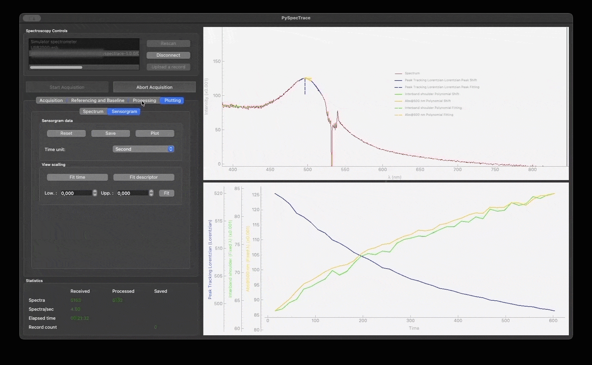

# PySpecTrace: Python-based Graphical User Interface (GUI) for Real-time UV-Vis-NIR Spectroscopy Analysis

**PySpecTrace** is an open-source, Python-based graphical user interface (GUI) designed for real-time UV-visible-NIR spectroscopy data analysis. It addresses the limitations of proprietary spectrometer software by providing advanced, customizable, and real-time spectral tracking and analysis tools suitable for a wide range of scientific disciplines.



### Requirements
* Python 3.9 – 3.12

***Notes for Avantes Spectrometer***: If the spectrometer is still not detected after placing the SDK, please Install the official Avantes interface software from https://www.avantes.com/products/software/

> Detailed steps for running documented in the Manual: [PySpecTrace_Manual.pdf](https://github.com/anamsigit/pyspectrace/blob/main/PySpecTrace_Manual.pdf)

_If you encounter any issues or need assistance, we will do our best to help. Please feel free to contact us via the **Corresponding Contact**_


## Installation

First of all, current PySpecTrace depends on old version dependencies including Python 3.9-3.12. Therefore, we recommend to install PySpecTrace within isolated conda environment (via a terminal or Command Prompt):

1. Create a dedicated environment (```pyspectracenv```):
```
conda create -n pyspectracenv python = 3.11
```
2. Activate the environment:
```
conda activate pyspectracenv
```
Within this environment, PySpecTrace can be installed using either (i) the Python Package Index (PyPI) or (ii) manual
installation from the source code repository. We recommend installation via PyPI because it automatically resolves and
installs the required dependencies.


After conda environment is activated, run the following command to install the latest version from PyPI:
```
pip install pyspectrace
```

### Running the Application 
After installation is complete, start the program with open terminal and write:
```
pyspectrace
```

### Spectrometer SDK Setup
To connect the software with supported spectrometers, you must manually provide the required SDK files (DLLs/shared libraries). These SDKs are proprietary and must be obtained directly from the hardware manufacturers.

You can add SDK files from the application menu:
1. Open 
2. Click menu bar ```SDK```.
3. Choose the vendor: ```Ocean Optics```, ```CNI Laser```, or ```Avantes```.
4. Select ```Add ... DLL``` and choose the required ```.dll``` file.
5. Close PySpecTrace then run again

PySpecTrace stores user-provided SDK files in the user data directory. This keeps the PyPI package free from proprietary SDK files.


## Extra Documentation
- **Peer-reviewed aarticle:** [https://doi.org/10.12688/f1000research.180635.1] (https://doi.org/10.12688/f1000research.180635.1)
- **Zenodo archive:** [doi.org/10.5281/zenodo.18918222](https://doi.org/10.5281/zenodo.18918222)
- **Repository:** [https://github.com/anamsigit/pyspectrace](https://github.com/anamsigit/pyspectrace)
- **Supporting information:** [PySpecTrace_SI.pdf](https://github.com/anamsigit/pyspectrace/blob/main/PySpecTrace_SI.pdf)
- **Demonstration video:** [Google drive](https://drive.google.com/file/d/1Tj6Fig017nFhzMavVcG9cRoBS5tbMKVn/view?usp=sharing)


## Key Features
- **Real-time spectral visualization:** Enables immediate monitoring of spectral changes during experiments.
- **Dynamic spectral tracing and peak tracking:** Utilizes adaptive fitting routines to identify and track spectral features live.
- **Flexible configuration:** User-friendly GUI includes panels for spectrometer connection, settings, data display, and analysis.
- **Spectral post-processing:** Offers robust data analysis capabilities for in-depth interpretation.
- **Spectrometer Simulator:** Supports testing without physical hardware, facilitating development and training.
- **Modular and adaptable:** Compatible with any spectrometer via appropriate driver interfaces; easily customizable for various experimental needs.

## Architecture
- Built on a **Model-View-Presenter (MVP)** pattern for maintainability and scalability.
- Uses popular Python libraries including **PyQt5, NumPy, SciPy, Pandas, Matplotlib, and PyQtGraph**.
- This project has been tested with **Python 3.9.13**.

## List of working spectrometers
PySpecTrace has been tested and working seamlessly with these commercial spectrometers (on Windows OS). Testing was performed using some instruments available from several research laboratories: Photonics Research Center of Indonesia; Chemistry Dept. of Chulalongkorn University; Electrical Eng. Dept. of Universiti Teknologi Malaysia; IMRAN, Tohoku University, Physics Dept. of Universitas Indonesia.

| Ocean Optics           | Avantes                      | CNI          |
|-----------------------|------------------------------|--------------|
| Maya PRO2000          | AvaSpec-ULS4096CL-EVO        | Aurora 4000  |
| HR 4000CG-UV-NIR      | AvaSpec-2048-USB2            |              |
| USB4000               |                              |              |

Please add to the list if you have found that it works in your spectrometer. It will be a nice information for new user.

## Running from Source
If you prefer to run the application directly from the source code
> 1. Navigate to the `src` directory:
> ```bash
> cd src
> 
> ```
> 
> 
> 2. Run the application using Python:
> ```bash
> python -m pyspectrace.main
> 
> ```


## Corresponding contact
- Feel free to contact us via Iwan Darmadi (email:iwan.darmadi@alumni.ui.ac.id) for technical support, bug reports, feature requests, or questions regarding 

## Citation
- If you find PySpecTrace is useful and contribute a meaningful improvement to your work, feel free to cite this work to our peer-reviewed article: Anam, S. K.; Leonardy, J.; Suwardi, S.; Baldi, A.; Nugroho, F. A. A.; Darmadi, I. PySpecTrace: A Python-Based Graphical User Interface for Real-Time Spectroscopy Analysis and Data Analysis. F1000Res, 2026, 15, 1187. https://doi.org/10.12688/f1000research.180635.1.


